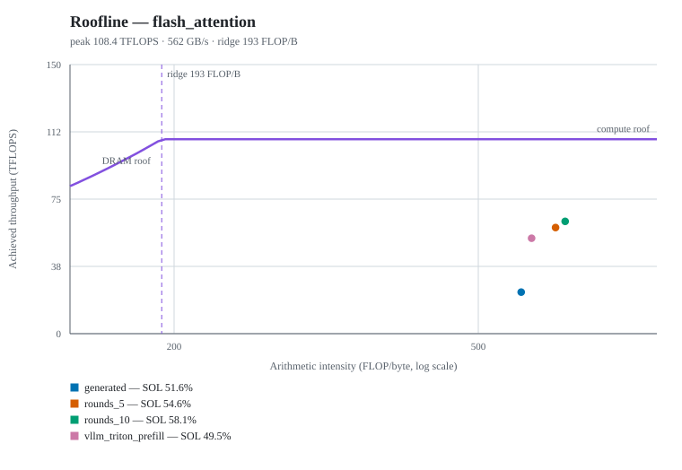

# Kernel comparison experiment: `flashattention-ada5000_v1`

- Status: **completed**
- Created: 2026-10-26T14:41:49.397753
- Report generated: 2026-10-28T17:19:40.938081
- Capture selection: newest capture of each profiler across 3 batch(es) (`latest-per-profiler`)
- Capture batches: `capture_20261026_151913_e52e`, `capture_20261026_211955_fdad`, `capture_20261026_212117_4e7d`
- Profiler batches: ncu ← `capture_20261026_212117_4e7d`

## Configuration

| Key | Value |
|---|---|
| Problems | flash_attention |
| Benchmark case | 0 |
| Generation rounds (budget) | 5 |
| Optimization budgets | 5, 10 |
| Workers | 1 |
| Generation LLM | openai / gpt-6-luna |
| Optimization LLM | openai / gpt-6.1-sol |
| Profilers | ncu |

## Environment

| Component | Version |
|---|---|
| GPU | NVIDIA RTX 5000 Ada Generation Laptop GPU |
| GPU memory | 16376 MiB |
| Driver | 615.78.08 |
| CUDA | nvcc: NVIDIA (R) Cuda compiler driver |
| PyTorch | 2.13.0+cu129 |
| Triton | 3.7.1 |
| KernelAgent | 0.1.0 |
| Nsight Compute | NVIDIA (R) Nsight Compute Command Line Profiler — 2025.2.1.0 |
| Nsight Systems | NVIDIA Nsight Systems version 2024.6.2.225-246235244400v0 |
| Python | 3.12.15 |
| Repository | — |

## flash_attention — benchmark case 0

Case: `(2, 8, 1024, 64, False, 'float16')`

### Benchmark (fixed harness, `do_bench` mean)

| Variant | Rounds used/budget | Fixed test | Status | Kernel (ms) | PyTorch (ms) | vs PyTorch | vs generated |
|---|---:|---|---|---:|---:|---:|---:|
| `generated` | 1/5 | PASS | verified | 0.1338 | 0.0677 | 0.51x | 1.00x |
| `rounds_5` | 5/5 | PASS | accepted | 0.4374 | 0.3296 | 0.75x | 0.31x |
| `rounds_10` | 10/10 | PASS | accepted | 0.3072 | 0.3540 | 1.15x | 0.44x |
| `vllm_triton_prefill` *(external baseline)* | — | PASS | verified | 0.0818 | 0.0638 | 0.78x | 1.64x |

Optimizer acceptance timings (the comparison each optimization session gated on, case 0):

| Variant | Source (ms) | Candidate (ms) | Accepted speedup |
|---|---:|---:|---:|
| `rounds_5` | 0.4419 | 0.4374 | 1.01x |
| `rounds_10` | 0.3816 | 0.3072 | 1.24x |

### Nsight Compute (`ncu`)

Each variant's newest `ncu` capture across capture batches (`latest-per-profiler`); `--set` and measured iterations come from the batch that produced each capture, so duration is the mean over profiled launches, and throughput and occupancy are per-launch means (% of peak).

TFLOPS is tensor-pipeline executed FLOPs (`sm__ops_path_tensor_*.sum`) over summed profiled launch time; collecting it requires `ncu --set full`.

| Variant | Kernel | Launches | Duration avg (µs) | TFLOPS | SM % | Memory % | DRAM % | Occupancy % | Reg/thread |
|---|---|---:|---:|---:|---:|---:|---:|---:|---:|
| `generated` | `_flash_attention_kernel` | 10 | 185.45 | 23.2 | 41.8 | 51.6 | 7.2 | 16.2 | 64 |
| `rounds_5` | `_flash_attention_kernel` | 10 | 72.62 | 59.1 | 54.6 | 20.8 | 16.7 | 13.0 | 248 |
| `rounds_10` | `_flash_attention` | 10 | 68.60 | 62.6 | 58.1 | 22.1 | 17.1 | 13.3 | 244 |
| `vllm_triton_prefill` | `_fwd_kernel` | 10 | 80.74 | 53.2 | 49.5 | 36.3 | 16.1 | 13.9 | 255 |

### Roofline and SOL

SOL percentages are Nsight Compute's own GPU Speed Of Light metrics: `Compute (SM) Throughput`, `Memory Throughput` (the busiest memory level, L1/L2 or DRAM), and `DRAM Throughput`. `SOL %` is the larger of compute and memory, as NCU's rule defines it, and `Bound` names that larger one.

The roofline derives arithmetic intensity from executed tensor FLOPs (`sm__ops_path_tensor_*.sum`) over DRAM read+write bytes, and takes its peaks from the same `--set full` raw capture. FLOPs and DRAM bytes are totals over the profiled launches; the peaks are duration-weighted means because NCU scales them with the sampled clock. It is a classic DRAM roofline, so a kernel can sit on the compute side of the ridge while NCU's cache-level memory SOL is the larger percentage.

`Limiter` adds heuristics from the same capture: occupancy below 25 % and register counts at or above 128 are secondary limits, not a second model.

#### Roofline

| Variant | Kernel | FLOPs (G) | DRAM (MB) | AI (FLOP/B) | Ridge (FLOP/B) | Peak TFLOPS | Peak DRAM GB/s | Roofline TFLOPS | Achieved TFLOPS | Achieved DRAM GB/s |
|---|---|---:|---:|---:|---:|---:|---:|---:|---:|---:|
| `generated` | `_flash_attention_kernel` | 42.9 | 75.5 | 568.9 | 192.4 | 108.2 | 562 | 108.2 | 23.2 | 40.7 |
| `rounds_5` | `_flash_attention_kernel` | 42.9 | 68.1 | 631.0 | 192.8 | 108.4 | 562 | 108.4 | 59.1 | 93.7 |
| `rounds_10` | `_flash_attention` | 42.9 | 66.1 | 649.5 | 191.8 | 107.8 | 562 | 107.8 | 62.6 | 96.4 |
| `vllm_triton_prefill` | `_fwd_kernel` | 42.9 | 73.2 | 587.1 | 191.3 | 107.5 | 562 | 107.5 | 53.2 | 90.6 |

#### Bottleneck

| Variant | Kernel | Compute SOL % | Memory SOL % | DRAM SOL % | SOL % | Bound | Limiter |
|---|---|---:|---:|---:|---:|---|---|
| `generated` | `_flash_attention_kernel` | 41.8 | 51.6 | 7.2 | 51.6 | memory | memory hierarchy (51.6%); cache-level pressure (DRAM 7.2%); low occupancy (16.2%) |
| `rounds_5` | `_flash_attention_kernel` | 54.6 | 20.8 | 16.7 | 54.6 | compute | tensor pipelines (54.6%); low occupancy (13.0%); register pressure (248/thread) |
| `rounds_10` | `_flash_attention` | 58.1 | 22.1 | 17.1 | 58.1 | compute | tensor pipelines (58.1%); low occupancy (13.3%); register pressure (244/thread) |
| `vllm_triton_prefill` | `_fwd_kernel` | 49.5 | 36.3 | 16.1 | 49.5 | compute | tensor pipelines (49.5%); low occupancy (13.9%); register pressure (255/thread) |

#### Artifacts

- `generated` · kernel: [final_kernel.py](../problems/flash_attention/generated/flash_attention/final_kernel.py) · sha256 `d1c93f8eb483…` · record: [verify.json](../problems/flash_attention/generated/flash_attention/verify.json) · summary: [generate_result.json](../problems/flash_attention/generated/flash_attention/generate_result.json) · ncu: [generated_ncu_case0.ncu-rep](../captures/capture_20261026_212117_4e7d/flash_attention/generated_ncu_case0.ncu-rep)
- `rounds_5` · kernel: [optimized_kernel.py](../problems/flash_attention/case_0/rounds_5/flash_attention/optimized_kernel.py) · sha256 `138f765d4df3…` · record: [verify_optimized.json](../problems/flash_attention/case_0/rounds_5/flash_attention/verify_optimized.json) · summary: [optimize_result.json](../problems/flash_attention/case_0/rounds_5/flash_attention/optimize_result.json) · ncu: [rounds_5_ncu_case0.ncu-rep](../captures/capture_20261026_212117_4e7d/flash_attention/rounds_5_ncu_case0.ncu-rep)
- `rounds_10` · kernel: [optimized_kernel.py](../problems/flash_attention/case_0/rounds_10/flash_attention/optimized_kernel.py) · sha256 `9b1431e00661…` · record: [verify_optimized.json](../problems/flash_attention/case_0/rounds_10/flash_attention/verify_optimized.json) · summary: [optimize_result.json](../problems/flash_attention/case_0/rounds_10/flash_attention/optimize_result.json) · ncu: [rounds_10_ncu_case0.ncu-rep](../captures/capture_20261026_212117_4e7d/flash_attention/rounds_10_ncu_case0.ncu-rep)
- `vllm_triton_prefill` · kernel: [kernel.py](../problems/flash_attention/baselines/vllm_triton_prefill/flash_attention/kernel.py) · sha256 `2c38b86851dd…` · source: `flash_attention/baselines/vllm_triton_prefill.py` · record: [verify_vllm_triton_prefill.json](../problems/flash_attention/baselines/vllm_triton_prefill/flash_attention/verify_vllm_triton_prefill.json) · ncu: [vllm_triton_prefill_ncu_case0.ncu-rep](../captures/capture_20261026_212117_4e7d/flash_attention/vllm_triton_prefill_ncu_case0.ncu-rep)

## Source diffs

- Code diff analysis: [code-diff-analysis.md](code-diff-analysis.md) — 6 pairs, 36 change groups
- flash_attention: `generated` → `rounds_5`: [flash_attention__generated_to_rounds_5.diff](source-diffs/flash_attention__generated_to_rounds_5.diff)
- flash_attention: `generated` → `rounds_10`: [flash_attention__generated_to_rounds_10.diff](source-diffs/flash_attention__generated_to_rounds_10.diff)
- flash_attention: `generated` → `vllm_triton_prefill`: [flash_attention__generated_to_vllm_triton_prefill.diff](source-diffs/flash_attention__generated_to_vllm_triton_prefill.diff)
- flash_attention: `rounds_5` → `rounds_10`: [flash_attention__rounds_5_to_rounds_10.diff](source-diffs/flash_attention__rounds_5_to_rounds_10.diff)
- flash_attention: `rounds_5` → `vllm_triton_prefill`: [flash_attention__rounds_5_to_vllm_triton_prefill.diff](source-diffs/flash_attention__rounds_5_to_vllm_triton_prefill.diff)
- flash_attention: `rounds_10` → `vllm_triton_prefill`: [flash_attention__rounds_10_to_vllm_triton_prefill.diff](source-diffs/flash_attention__rounds_10_to_vllm_triton_prefill.diff)

## Interpreting the numbers

- Benchmark latencies come from the fixed `bench.py` harness (`triton.testing.do_bench` means over the exact case shapes and dtype); profiler durations come from each tool's own measurement of the captured launches and are not interchangeable with them.
- `rounds used/budget` reports the optimizer's completed rounds against the requested budget (`KA_ROUNDS` is a maximum; a run may stop earlier).
- Every optimization budget started from the same generated kernel (hash-checked); rejected or failed attempts keep their outcome and are never replaced by another variant's kernel.
- The Roofline and SOL section uses NCU's own Speed Of Light percentages; its arithmetic intensity and roofs come from the capture's executed tensor FLOPs, DRAM traffic, and peak-sustained rates, so they need `ncu --set full` and describe what the kernel actually executed, not an algorithmic FLOP model. DRAM counters exclude traffic served from L2, so a cache-friendly kernel shows a higher arithmetic intensity than its total memory work implies.
- Peak-sustained rates are the clocks NCU sampled during the capture; laptop power and thermal limits keep sustained performance below those peaks, and the limiter flags are heuristics over the same metrics.

