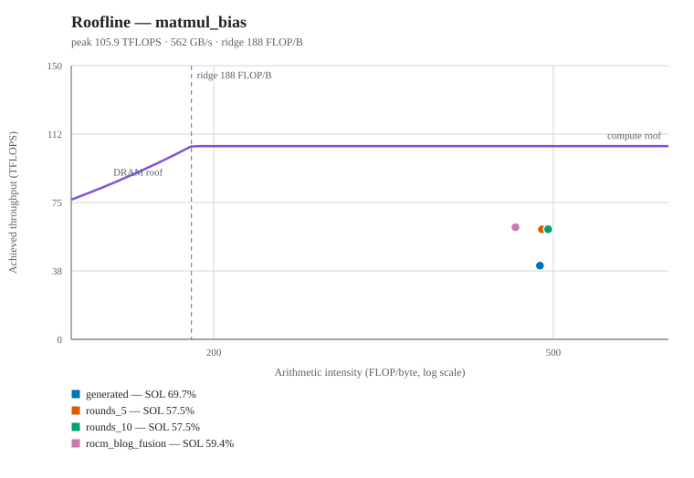

# Kernel comparison experiment: `matmulbias-ada5000_v1`

- Status: **completed**
- Created: 2026-10-26T14:09:36.676368
- Report generated: 2026-10-28T15:09:07.267520
- Capture selection: newest capture of each profiler across 2 batch(es) (`latest-per-profiler`)
- Capture batches: `capture_20261026_143346_e551`, `capture_20261026_153544_0129`
- Profiler batches: ncu ← `capture_20261026_143346_e551`, `capture_20261026_153544_0129`

## Configuration

| Key | Value |
|---|---|
| Problems | matmul_bias |
| Benchmark case | 0 |
| Generation rounds (budget) | 5 |
| Optimization budgets | 5, 10 |
| Workers | 1 |
| Generation LLM | openai / gpt-6-luna |
| Optimization LLM | openai / gpt-6.1-sol |
| Profilers | ncu |

## Environment

| Component | Version |
|---|---|
| GPU | NVIDIA RTX 5000 Ada Generation Laptop GPU |
| GPU memory | 16376 MiB |
| Driver | 615.78.08 |
| CUDA | nvcc: NVIDIA (R) Cuda compiler driver |
| PyTorch | 2.13.0+cu129 |
| Triton | 3.7.1 |
| KernelAgent | 0.1.0 |
| Nsight Compute | NVIDIA (R) Nsight Compute Command Line Profiler — 2025.2.1.0 |
| Nsight Systems | NVIDIA Nsight Systems version 2024.6.2.225-246235244400v0 |
| Python | 3.12.15 |
| Repository | — |

## matmul_bias — benchmark case 0

Case: `(1024, 1024, 1024, 'float16')`

### Benchmark (fixed harness, `do_bench` mean)

| Variant | Rounds used/budget | Fixed test | Status | Kernel (ms) | PyTorch (ms) | vs PyTorch | vs generated |
|---|---:|---|---|---:|---:|---:|---:|
| `generated` | 1/5 | PASS | verified | 0.0404 | 0.0262 | 0.65x | 1.00x |
| `rounds_5` | 5/5 | PASS | accepted | 0.0253 | 0.0241 | 0.96x | 1.60x |
| `rounds_10` | 8/10 | PASS | accepted | 0.0249 | 0.0243 | 0.97x | 1.62x |
| `rocm_blog_fusion` *(external baseline)* | — | PASS | verified | 0.0429 | 0.1819 | 4.24x | 0.94x |

Optimizer acceptance timings (the comparison each optimization session gated on, case 0):

| Variant | Source (ms) | Candidate (ms) | Accepted speedup |
|---|---:|---:|---:|
| `rounds_5` | 0.0403 | 0.0253 | 1.59x |
| `rounds_10` | 0.0404 | 0.0249 | 1.62x |

### Nsight Compute (`ncu`)

Each variant's newest `ncu` capture across capture batches (`latest-per-profiler`); `--set` and measured iterations come from the batch that produced each capture, so duration is the mean over profiled launches, and throughput and occupancy are per-launch means (% of peak).

TFLOPS is tensor-pipeline executed FLOPs (`sm__ops_path_tensor_*.sum`) over summed profiled launch time; collecting it requires `ncu --set full`.

| Variant | Kernel | Launches | Duration avg (µs) | TFLOPS | SM % | Memory % | DRAM % | Occupancy % | Reg/thread |
|---|---|---:|---:|---:|---:|---:|---:|---:|---:|
| `generated` | `_matmul_bias_kernel` | 10 | 53.16 | 40.4 | 38.2 | 69.7 | 14.9 | 54.0 | 53 |
| `rounds_5` | `_matmul_bias_kernel` | 10 | 35.61 | 60.3 | 57.5 | 53.7 | 22.1 | 14.2 | 150 |
| `rounds_10` | `_matmul_bias_kernel` | 10 | 35.59 | 60.3 | 57.5 | 53.7 | 21.8 | 14.2 | 150 |
| `rocm_blog_fusion` | `matmulbias_kernel` | 10 | 34.96 | 61.4 | 59.4 | 38.1 | 24.2 | 8.3 | 255 |

### Roofline and SOL

SOL percentages are Nsight Compute's own GPU Speed Of Light metrics: `Compute (SM) Throughput`, `Memory Throughput` (the busiest memory level, L1/L2 or DRAM), and `DRAM Throughput`. `SOL %` is the larger of compute and memory, as NCU's rule defines it, and `Bound` names that larger one.

The roofline derives arithmetic intensity from executed tensor FLOPs (`sm__ops_path_tensor_*.sum`) over DRAM read+write bytes, and takes its peaks from the same `--set full` raw capture. FLOPs and DRAM bytes are totals over the profiled launches; the peaks are duration-weighted means because NCU scales them with the sampled clock. It is a classic DRAM roofline, so a kernel can sit on the compute side of the ridge while NCU's cache-level memory SOL is the larger percentage.

`Limiter` adds heuristics from the same capture: occupancy below 25 % and register counts at or above 128 are secondary limits, not a second model.

#### Roofline

| Variant | Kernel | FLOPs (G) | DRAM (MB) | AI (FLOP/B) | Ridge (FLOP/B) | Peak TFLOPS | Peak DRAM GB/s | Roofline TFLOPS | Achieved TFLOPS | Achieved DRAM GB/s |
|---|---|---:|---:|---:|---:|---:|---:|---:|---:|---:|
| `generated` | `_matmul_bias_kernel` | 21.5 | 44.5 | 482.3 | 188.3 | 105.9 | 562 | 105.9 | 40.4 | 83.8 |
| `rounds_5` | `_matmul_bias_kernel` | 21.5 | 44.3 | 485.1 | 186.8 | 104.9 | 562 | 104.9 | 60.3 | 124.3 |
| `rounds_10` | `_matmul_bias_kernel` | 21.5 | 43.5 | 493.2 | 186.6 | 104.9 | 562 | 104.9 | 60.3 | 122.3 |
| `rocm_blog_fusion` | `matmulbias_kernel` | 21.5 | 47.6 | 451.6 | 184.1 | 103.4 | 562 | 103.4 | 61.4 | 136.0 |

#### Bottleneck

| Variant | Kernel | Compute SOL % | Memory SOL % | DRAM SOL % | SOL % | Bound | Limiter |
|---|---|---:|---:|---:|---:|---|---|
| `generated` | `_matmul_bias_kernel` | 38.2 | 69.7 | 14.9 | 69.7 | memory | memory hierarchy (69.7%); cache-level pressure (DRAM 14.9%) |
| `rounds_5` | `_matmul_bias_kernel` | 57.5 | 53.7 | 22.1 | 57.5 | compute | tensor pipelines (57.5%); low occupancy (14.2%); register pressure (150/thread) |
| `rounds_10` | `_matmul_bias_kernel` | 57.5 | 53.7 | 21.8 | 57.5 | compute | tensor pipelines (57.5%); low occupancy (14.2%); register pressure (150/thread) |
| `rocm_blog_fusion` | `matmulbias_kernel` | 59.4 | 38.1 | 24.2 | 59.4 | compute | tensor pipelines (59.4%); low occupancy (8.3%); register pressure (255/thread) |

#### Artifacts

- `generated` · kernel: [final_kernel.py](../problems/matmul_bias/generated/matmul_bias/final_kernel.py) · sha256 `5ba2fb340021…` · record: [verify.json](../problems/matmul_bias/generated/matmul_bias/verify.json) · summary: [generate_result.json](../problems/matmul_bias/generated/matmul_bias/generate_result.json) · ncu: [generated_ncu_case0.ncu-rep](../captures/capture_20261026_143346_e551/matmul_bias/generated_ncu_case0.ncu-rep)
- `rounds_5` · kernel: [optimized_kernel.py](../problems/matmul_bias/case_0/rounds_5/matmul_bias/optimized_kernel.py) · sha256 `e71fe54ed298…` · record: [verify_optimized.json](../problems/matmul_bias/case_0/rounds_5/matmul_bias/verify_optimized.json) · summary: [optimize_result.json](../problems/matmul_bias/case_0/rounds_5/matmul_bias/optimize_result.json) · ncu: [rounds_5_ncu_case0.ncu-rep](../captures/capture_20261026_143346_e551/matmul_bias/rounds_5_ncu_case0.ncu-rep)
- `rounds_10` · kernel: [optimized_kernel.py](../problems/matmul_bias/case_0/rounds_10/matmul_bias/optimized_kernel.py) · sha256 `30091c7800b1…` · record: [verify_optimized.json](../problems/matmul_bias/case_0/rounds_10/matmul_bias/verify_optimized.json) · summary: [optimize_result.json](../problems/matmul_bias/case_0/rounds_10/matmul_bias/optimize_result.json) · ncu: [rounds_10_ncu_case0.ncu-rep](../captures/capture_20261026_143346_e551/matmul_bias/rounds_10_ncu_case0.ncu-rep)
- `rocm_blog_fusion` · kernel: [kernel.py](../problems/matmul_bias/baselines/rocm_blog_fusion/matmul_bias/kernel.py) · sha256 `ef1f4165e29f…` · source: `matmul_bias/baselines/rocm_blog_fusion.py` · record: [verify_rocm_blog_fusion.json](../problems/matmul_bias/baselines/rocm_blog_fusion/matmul_bias/verify_rocm_blog_fusion.json) · ncu: [rocm_blog_fusion_ncu_case0.ncu-rep](../captures/capture_20261026_153544_0129/matmul_bias/rocm_blog_fusion_ncu_case0.ncu-rep)

## Source diffs

- matmul_bias: `generated` → `rounds_5`: [matmul_bias__generated_to_rounds_5.diff](source-diffs/matmul_bias__generated_to_rounds_5.diff)
- matmul_bias: `generated` → `rounds_10`: [matmul_bias__generated_to_rounds_10.diff](source-diffs/matmul_bias__generated_to_rounds_10.diff)
- matmul_bias: `generated` → `rocm_blog_fusion`: [matmul_bias__generated_to_rocm_blog_fusion.diff](source-diffs/matmul_bias__generated_to_rocm_blog_fusion.diff)
- matmul_bias: `rounds_5` → `rounds_10`: [matmul_bias__rounds_5_to_rounds_10.diff](source-diffs/matmul_bias__rounds_5_to_rounds_10.diff)
- matmul_bias: `rounds_5` → `rocm_blog_fusion`: [matmul_bias__rounds_5_to_rocm_blog_fusion.diff](source-diffs/matmul_bias__rounds_5_to_rocm_blog_fusion.diff)
- matmul_bias: `rounds_10` → `rocm_blog_fusion`: [matmul_bias__rounds_10_to_rocm_blog_fusion.diff](source-diffs/matmul_bias__rounds_10_to_rocm_blog_fusion.diff)

## Interpreting the numbers

- Benchmark latencies come from the fixed `bench.py` harness (`triton.testing.do_bench` means over the exact case shapes and dtype); profiler durations come from each tool's own measurement of the captured launches and are not interchangeable with them.
- `rounds used/budget` reports the optimizer's completed rounds against the requested budget (`KA_ROUNDS` is a maximum; a run may stop earlier).
- Every optimization budget started from the same generated kernel (hash-checked); rejected or failed attempts keep their outcome and are never replaced by another variant's kernel.
- The Roofline and SOL section uses NCU's own Speed Of Light percentages; its arithmetic intensity and roofs come from the capture's executed tensor FLOPs, DRAM traffic, and peak-sustained rates, so they need `ncu --set full` and describe what the kernel actually executed, not an algorithmic FLOP model. DRAM counters exclude traffic served from L2, so a cache-friendly kernel shows a higher arithmetic intensity than its total memory work implies.
- Peak-sustained rates are the clocks NCU sampled during the capture; laptop power and thermal limits keep sustained performance below those peaks, and the limiter flags are heuristics over the same metrics.

